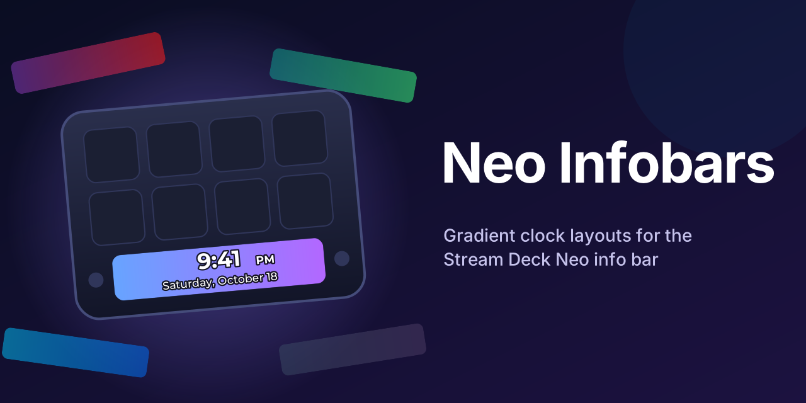

# Stream Deck Neo Custom Infobars

Custom clock layouts for the Stream Deck Neo info bar. Each layout shows the time and date over a gradient background, with dream, mystic, ocean and forest themes. `custom_gradient` puts the date under the time, and `custom_gradient_split` shows the weekday and date beside it, past a thin divider.

